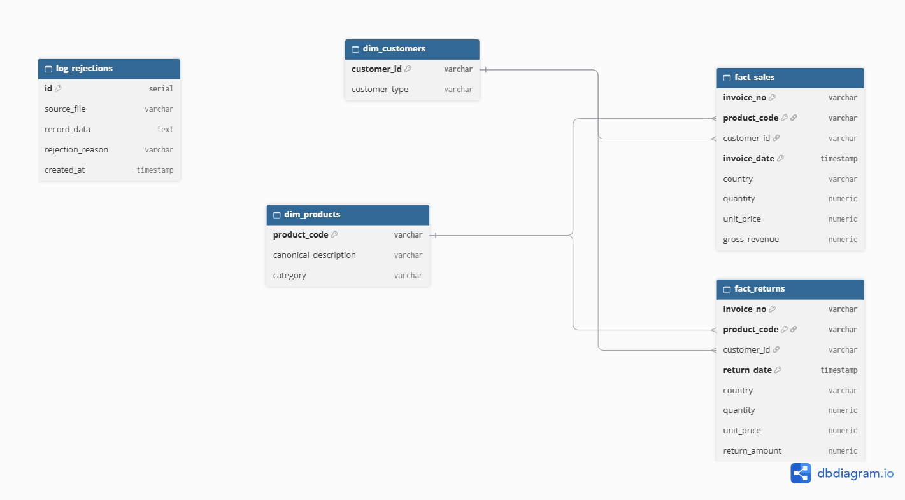

# DataMart ETL Pipeline

## Overview
An enterprise-grade, idempotent ETL pipeline built with **Apache Airflow**, **Python (Pandas/NumPy)**, **PostgreSQL (Data Warehouse)**, and **Docker Compose**. The system extracts, normalizes, deduplicates, and loads multi-source retail datasets into a high-performance Star Schema optimized for analytical querying and business intelligence.

- **GitHub Repository**: [https://github.com/jhonnyelithAZ/retail-datamart-pipeline.git](https://github.com/jhonnyelithAZ/retail-datamart-pipeline.git)

---

## Architecture & Data Model
The Data Warehouse follows a dimensional **Star Schema** designed to separate business events, customer demographics, product catalogs, and data quality logs:

- **`dim_customers`**: Unique customer records with standardized customer types (`Registered` vs `UNKNOWN`).
- **`dim_products`**: Product catalog featuring canonical uppercase descriptions grouped by `StockCode`.
- **`fact_sales`**: Financial transactions where quantity > 0, complete with calculated `GrossRevenue`.
- **`fact_returns`**: Returned items where quantity <= 0, capturing absolute return quantities and `ReturnAmount`.
- **`log_rejections`**: Audit table isolating invalid records (e.g., unit price <= 0) for data quality tracking without breaking analytics.

---

## Key Technical Decisions & Robustness

1. **Multi-Source Unification & Deduplication**:
   - The pipeline ingests and merges two comprehensive datasets (daily operational dumps and historical data).
   - Columns are dynamically normalized and overlapping date ranges are cleaned using composite subset deduplication (`InvoiceNo`, `StockCode`, `InvoiceDate`, `Quantity`) to prevent data inflation.

2. **Idempotency**:
   - Built with strict idempotency principles. Dimension tables utilize `ON CONFLICT DO NOTHING` on primary keys, and fact tables leverage composite unique keys (`invoice_no`, `product_code`, `invoice_date`/`return_date`), ensuring multiple DAG executions yield identical, non-duplicated states.

3. **High-Performance Bulk Loading**:
   - Leverages `psycopg2.extras.execute_values` for bulk inserts, reducing load times for hundreds of thousands of rows to under a minute.

4. **Ambiguity Resolution**:
   - Missing customer IDs are systematically mapped to `UNKNOWN` rather than dropped, preserving true financial totals.
   - Product descriptions are standardized to uppercase with normalized spacing, keeping the first historical appearance as the canonical reference.

---

## Repository Structure
```text
retail-datamart-pipeline/
├── dags/
│   └── etl_datamart.py          # Airflow DAG containing extract, transform, and load tasks
├── data/
│   └── raw_data.zip             # Compressed raw datasets (extracted locally into CSVs)
├── docs/
│   ├── diagrama_datamart.png    # ER Diagram / Star Schema visualization
│   └── technical_decisions.md   # Deep-dive architectural decisions and solutions
├── sql/
│   ├── init.sql                 # Database schema initialization script
│   └── business_queries.sql     # Business Intelligence and analytical SQL queries
├── .env.example                 # Environment variables template
├── .gitignore                   # Git exclusions (ignores .env, raw CSVs, etc.)
└── docker-compose.yml           # Multi-container orchestration (Airflow + PostgreSQL DW)
```

---

## Prerequisites & Installation (Under 10 Minutes)

1. **Clone the repository** and navigate into the project root directory:
   ```bash
   git clone https://github.com/jhonnyelithAZ/retail-datamart-pipeline.git
   cd retail-datamart-pipeline
   ```
2. Ensure **Docker** and **Docker Compose** are installed and running on your system.
3. **Prepare the Data (Extraction)**:
   Due to GitHub's file size limits and Data Engineering best practices, the heavy raw CSV files are versioned inside a compressed archive (`raw_data.zip`) located in the `data/` folder. 
   
   Before running containers, extract the dataset so the pipeline can read it:
   ```bash
   cd data/
   unzip raw_data.zip
   cd ..
   ```
   *(Note: The project's `.gitignore` is configured to automatically ignore any extracted `.csv` files in this folder, ensuring your version control remains clean).*

4. Create a `.env` file in the root folder with your local UID configuration (preventing volume permission issues):
   ```bash
   echo "AIRFLOW_UID=50000" > .env
   ```

---

## Running the Pipeline

1. **Spin up the infrastructure** using Docker Compose:
   ```bash
   docker compose up -d
   ```
2. **Access the Airflow Web UI** in your browser at `http://localhost:8080`:
   * **Username**: `airflow`
   * **Password**: `airflow`
3. Locate the `datamart_etl_pipeline` DAG in the dashboard.
4. Toggle the switch to **Active** and click the **Trigger DAG (▶)** button.
5. Monitor the task progression (`extract_and_transform` -> `load_dimensions` -> `load_facts`). All tasks will complete in green status within ~60 seconds.

---

## Database Verification & Business Intelligence

To inspect the loaded data or run analytical reports directly from your terminal against the PostgreSQL data warehouse:

```bash
docker exec -it retail-datamart-pipeline-postgres-dw-1 psql -U dw_user -d datamart_dw
```

### Analytical & Reporting Queries (`sql/business_queries.sql`)
You can execute the complete suite of predefined business intelligence queries (covering revenue by country, top products, customer lifetime value, monthly trends, and data quality audit logs) directly from your host terminal:

```bash
docker exec -i retail-datamart-pipeline-postgres-dw-1 psql -U dw_user -d datamart_dw < sql/business_queries.sql
```

### Quick Validation Queries:
- **Total Sales Count**:
  ```sql
  SELECT COUNT(*) AS total_ventas FROM fact_sales;
  ```
- **Date Range Check (Historical + Daily Unification)**:
  ```sql
  SELECT MIN(invoice_date) AS primera_venta, MAX(invoice_date) AS ultima_venta FROM fact_sales;
  ```

---

## ER Diagram (Star Schema)


---

## 📬 Contact

<p>
  <a href="https://github.com/jhonnyelithAZ" target="_blank">
    
  </a>
  <a href="https://www.linkedin.com/in/jhonatan-elith-ayala-sanchz/?locale=en-US" target="_blank">
    
  </a>
  <a href="mailto:jhonatanayala3478@gmail.com">
    
  </a>
</p>